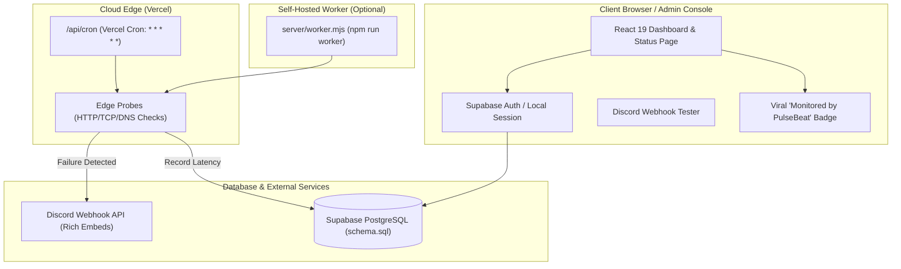

# 🚀 PulseBeat & HookRelay — Progress Checkpoint & Handover

> **Saved at:** 2026-10-24 01:58 (Local Time)  
> **Status:** All changes committed, verified, and pushed to remote GitHub repositories. Live on Vercel.

---

## 📍 Live Deployments & Repositories

| Project | Live URL | GitHub Repository | Current Status |
| :--- | :--- | :--- | :--- |
| **PulseBeat** | [https://pulsebeat-roan.vercel.app](https://pulsebeat-roan.vercel.app) | [TaskinXZ/PulseBeat](https://github.com/TaskinXZ/PulseBeat) | **Full-Stack SaaS Ready** (Auth, DB Schema, Cron Worker, Discord Alerts, Viral Footer) |
| **HookRelay** | [https://hookrelay-blond.vercel.app](https://hookrelay-blond.vercel.app) | [TaskinXZ/HookRelay](https://github.com/TaskinXZ/HookRelay) | Frontend simulator live, ready for backend integration |

---

## 🏗️ Architecture & Completed Systems in PulseBeat

---

## 🛠️ Detailed Checklist of Completed Work

### 1. Minimalist UI & Navigation Overhaul
* Replaced the previous single-column scroll with clean tabbed workspace navigation:
  * **Monitors:** Real-time metrics (90d uptime, avg latency, SSL health), 60-day interactive history blocks, simulated outage toggle.
  * **Incidents:** Complete incident lifecycle management (`Investigating` $\rightarrow$ `Identified` $\rightarrow$ `Monitoring` $\rightarrow$ `Resolved`).
  * **Discord & Alerts:** Live webhook testing suite and interactive Discord embed preview.
  * **Database & Cloud Sync:** Supabase connection status, credentials inputs, and schema copy button.
  * **Status Page & Branding:** Public status page customization, custom domain CNAME instructions, and embeddable SVG widget generator.
  * **Plans & Monetization:** 3-tier SaaS packaging (Hobby $0, Pro $9/mo, Team $29/mo) with 1-click upgrade testing.

### 2. "Monitored by PulseBeat" Viral Footer & White-Label Pro Toggle
* **Public Status View:** Displays a subtle, high-converting footer badge:  
  `⚡ Monitored by PulseBeat • Get your free status page →`
* **Pro White-Labeling:** Built into the **Status Page & Branding** tab. Free users are prompted to upgrade to Pro ($9/mo) to hide the badge; Pro users can toggle it off for a 100% white-label status page.

### 3. Native Discord Webhook Tester
* **Live 10-Second Test:** Dispatches rich red outage embeds (`🚨 Outage Alert`) or green recovery embeds (`✅ Resolved`) directly to the user's Discord server.
* **Browser CORS Bypass:** Built with `FormData` + `payload_json` to deliver messages without browser CORS preflight restrictions.
* **Dark Mode Simulator:** Displays an in-app preview of how the alert looks in Discord dark mode (`#313338`).
* Includes a **"Copy cURL Command"** button for terminal verification.

### 4. Authentication (Supabase + Local Fallback)
* Created [`src/services/authStore.ts`](file:///home/zas/Work/pulsebeat/src/services/authStore.ts) and [`src/services/supabase.ts`](file:///home/zas/Work/pulsebeat/src/services/supabase.ts).
* Supports **Sign Up**, **Sign In**, and **Sign Out** with persistent session management.
* Displays user avatar and active email in the top navigation bar.

### 5. PostgreSQL Database Schema
* Created [`supabase/schema.sql`](file:///home/zas/Work/pulsebeat/supabase/schema.sql) with 6 production tables:
  * `profiles`, `monitors`, `ping_logs`, `incidents`, `incident_updates`, and `subscribers`.
  * Includes Row Level Security (RLS) policies so each user's monitors remain strictly private.

### 6. 24/7 Autonomous Background Ping Engine
* **Vercel Cron Worker:** Created [`api/cron.ts`](file:///home/zas/Work/pulsebeat/api/cron.ts) and [`vercel.json`](file:///home/zas/Work/pulsebeat/vercel.json) running on schedule `* * * * *`. Pings target endpoints every minute from the cloud even when the browser is closed.
* **Standalone Daemon:** Created [`server/worker.mjs`](file:///home/zas/Work/pulsebeat/server/worker.mjs) runnable with `npm run worker` for hosting on a VPS, Docker, Render, or Railway.

---

## 🎯 When You Return: Exact Resumption Steps

When you get back to continue this project, here are the next high-value actions:

1. **Connect Free Supabase Database:**
   * Go to [supabase.com](https://supabase.com) and create a free project.
   * Paste [`supabase/schema.sql`](file:///home/zas/Work/pulsebeat/supabase/schema.sql) into the Supabase SQL Editor and click **Run**.
   * Open the live app, navigate to **Database & Cloud Sync**, and paste your **Project URL** and **Anon Key**.
2. **Add Custom Domain on Vercel:**
   * Purchase a domain (e.g., `pulsebeat.dev` or `pulsebeat.io`) and attach it in the Vercel Project Settings to replace `pulsebeat-roan.vercel.app`.
3. **Connect Payment Gateway (Monetization):**
   * Integrate **Lemon Squeezy** or **Stripe Checkout** links onto the Pro ($9/mo) and Team ($29/mo) buttons in the **Plans & Monetization** tab.
4. **Acquire First 50 Users:**
   * Submit to [AlternativeTo.net](https://alternativeto.net) as a free alternative to BetterStack.
   * Post a *"Show HN: PulseBeat"* on Hacker News and in `r/selfhosted` / `r/SideProject`.
